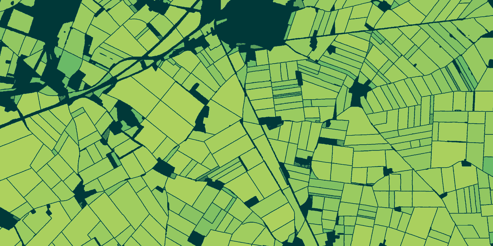

# ftw-cli

Field boundaries for any place on Earth, from your terminal. `ftw` queries the [Fields of The World](https://fieldsofthe.world/) 2nd Edition in place (every agricultural field from 2017 to 2025), exports any area to the format you work in, and runs the FTW models on new Sentinel-2 imagery without PyTorch.



<sub>`ftw view "1.55,48.20,1.70,48.30" --out beauce.png`: 986 fields in Beauce, France, from the 2025 edition, colored by model score.</sub>

## Install

```sh
uv tool install 'ftw-cli[inference,tui] @ git+https://github.com/fieldsoftheworld/cli'
ftw --install-completion
```

The base install queries, exports, and draws the 2nd Edition. The `imagery` extra adds Sentinel-2 download, `inference` adds the models, and `tui` adds the interactive browser.

## Use

An area is a place name or `xmin,ymin,xmax,ymax` in degrees. Place names go through OpenStreetMap's geocoder and are cached.

```sh
ftw data query "Story County, Iowa"                  # field count, area, mean score
ftw data history "Ames, Iowa"                        # the same for every year, with a trend line
ftw data query "Poltava, Ukraine" --year 2024 --out poltava.parquet
ftw view "Chartres, France" --out chartres.png       # a map of the fields
```

`--out` writes `.parquet`, `.geojson`, `.gpkg`, or `.fgb`. Queries read only the parts of the 2nd Edition that overlap the area, so a county in Iowa takes about 8 seconds.

`ftw data history` ends its table of the nine years with a trend line:

```text
fields  2017 █▅█▇▁▃▄▄▄ 2025  -14% since 2017
```

## Detect fields on new imagery

```sh
ftw infer all "Ames, Iowa" --year 2024 --out-dir ames
```

This picks the least cloudy Sentinel-2 scenes near planting and harvest from the crop calendar, downloads them, runs a PRUE model through onnxruntime (on a GPU if there is one), and splits the result into fields with BoundaryVote ([ftw-fbp](https://pypi.org/project/ftw-fbp/)'s `FTW_2E`, the setting behind the 2nd Edition). The steps are also separate commands:

```sh
ftw imagery download "Ames, Iowa" --year 2024 --out ames.tif
ftw infer run ames.tif --out scores.tif --model prue-ccby-b7
ftw infer polygonize scores.tif --out fields.parquet
```

`ftw models list` shows the models. They download once to `~/.cache/ftw-cli` (or `$FTW_CACHE_DIR`). The polygons are GeoParquet in EPSG:4326 with the same columns as the 2nd Edition.

## Browse

```sh
ftw tui
```

The TUI shows the fields of an area on a map colored by model score, with a summary and a table of the largest fields. `r` queries, `e` exports to GeoParquet, and `q` quits. The map is a full-resolution image in terminals with the kitty or sixel graphics protocols (kitty, WezTerm, iTerm2, recent Windows Terminal) and colored blocks elsewhere, including over SSH.

## For scripts and agents

Every command prints JSON when its output is piped, or with `--json`, and tables in a terminal. Progress goes to stderr and only in a terminal. Errors go to stderr with a non-zero exit, and nothing prompts.

```sh
ftw data query "Chartres, France" --year 2023 | jq .fields
```

## Develop

```sh
uv sync --all-extras
uv run pre-commit run --all-files
uv run pytest                 # unit tests
uv run pytest -m integration  # reads from Source Coop
```

[docs/design.md](docs/design.md) covers the design and what is planned.
